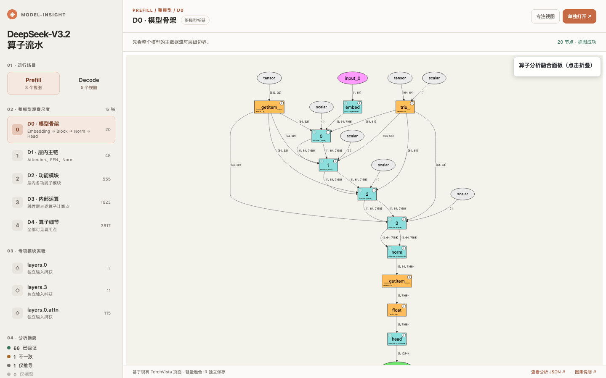

# Model Insight

**面向 PyTorch 模型源码的算子分析工具包。** 结合 AI 逻辑推导与 [TorchVista](https://github.com/sachinhosmani/torchvista) 运行捕获，生成可追溯的分析数据和分层交互图，辅助模型适配与算子需求评估。

[快速开始](#快速开始) · [示例](#示例) · [验证结果](RESULTS.md) · [Agent 规程](agent-kit_ops-analysis/SKILL.md)



## 核心能力

- **源码分析**：梳理模型层级、条件分支、算子与张量的逻辑 shape/dtype。
- **运行捕获**：在选定场景下记录实际执行的模块、shape 和 dtype。
- **证据融合**：对齐推导与捕获结果，保留源码行号、运行场景、差异和未验证项。
- **分层浏览**：从模型、模块逐级查看算子与张量流动。

## 示例

仓库包含 [DeepSeek-V3.2](outputs/DeepSeek-V3.2/) 和 [Kimi-K3](outputs/Kimi-K3/) 的分析产物。启动本地服务即可浏览已有页面：

```bash
git clone https://github.com/Jackie2049/model-insight.git
cd model-insight
python3 -m http.server 8899
```

- [DeepSeek-V3.2 统一主页](http://127.0.0.1:8899/outputs/DeepSeek-V3.2/viz/index.html)
- [Kimi-K3 页面导览](outputs/Kimi-K3/viz/README.md)

测试覆盖、结果与限制见 [RESULTS.md](RESULTS.md)。

## 快速开始

需要 Python ≥ 3.10，以及能够读取文件、执行命令的 AI 编码代理。

```bash
python3 -m venv .venv
.venv/bin/pip install -r requirements.txt
.venv/bin/python agent-kit_ops-analysis/tests/run_tests.py
```

将模型实现和配置放入 `inputs/<模型名>/`，向代理发送：

```text
阅读 agent-kit_ops-analysis/SKILL.md，分析 inputs/<模型名>/ 中的模型毛坯。
按规程将结果写入 outputs/<模型名>/，并依据 agent-kit_ops-analysis/SPEC.md 自检。
```

核心工作流位于 [`agent-kit_ops-analysis/`](agent-kit_ops-analysis/)；模型专属的运行适配和分析产物保存在对应的 `outputs/<模型名>/`。

## 输出

| 路径 | 内容 |
|---|---|
| `fusion/final_ir.json` | 逻辑与捕获 shape/dtype、源码依据、场景及分析状态 |
| `fusion/diff_report.md` | 差异与复核记录 |
| `viz/` | 分层交互图 |
| `llm-analysis/`、`capture/` | 两路独立分析的记录 |

以上路径均位于 `outputs/<模型名>/`。JSON 字段由 [schema 校验器](agent-kit_ops-analysis/scripts/ir_schema.py) 约束。

## 当前范围

示例运行使用**缩小规模、随机初始化**的模型实例；捕获的 shape 对应各自的测试配置。部分外部 kernel 使用有记录的替换实现，验证等级及未覆盖范围见 [验证结果](RESULTS.md)。当前通过 AI 编码代理运行，尚无在线上传入口。

项目代码采用 [MIT License](LICENSE)；`inputs/` 中的第三方模型源码遵循各自的许可。
