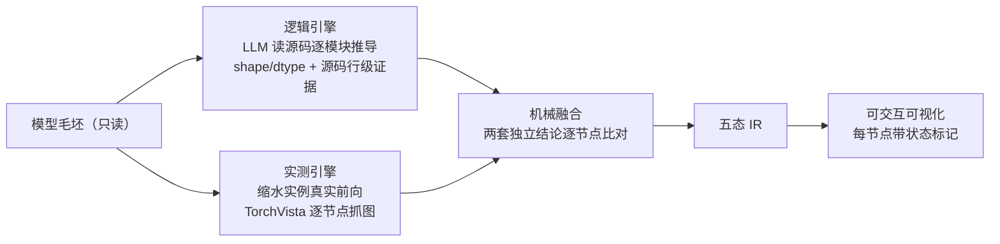

<div align="center">

# model-insight

**把「读懂一个模型的算子流水」交给一个 AI 编码代理**

双引擎独立分析 · 机械融合去伪存真 · 交付可交互的算子级可视化

[](LICENSE)
[](https://www.python.org)

不联网 · 不下载权重 · 不改模型源码 · 全链可重跑

</div>

---

接手一份陌生的模型源码，想知道**每一层、每个算子的 shape/dtype 是怎么流的**？
传统做法是人工读几万行源码逐层推导——费时、易错，而且**没有独立手段核对**。

model-insight 把这件事变成一条自动化流水线：一个**上下文空白的 AI 编码代理**，
仅凭一套操作知识（本仓库的 kit）+ 一句话驱动语，对模型毛坯完成全量算子分析，
交付每个节点带状态标记的可交互页面。你只需要读结果、核对证据。

## 它是怎么工作的



两个引擎**彼此独立**：逻辑分析必须先于一切抓图完成（文件时间链可审计）；
融合由脚本机械比对，不是"再让 LLM 圆一遍"。对不上的节点**显式保留、绝不静默**——

| 页面标记 | 含义 |
|---|---|
| 🟢 绿描边 | `verified`——逻辑推导与实测一致 |
| 🟠 橙描边 | `mismatch` / `conflict`——两侧不一致，差异细节与归因全程可追溯 |
| ⚪ 无标记 | `llm_only`——仅逻辑覆盖（如未执行分支），面板明示"尚未运行验证" |
| 🔴 红虚线 | 等价替换件（shim）——非模型本征，一眼可辨 |

**模型引用了本机没有的 kernel 怎么办？**（tilelang、flash-attn、自研 CUDA 核……）
代理为它编写**数学等价替换件**并做对拍验证，验证到哪一级就如实标注到哪一级——
替换件的行为永远不会被冒充成模型本征行为。

## 快速开始

```bash
git clone https://github.com/Jackie2049/model-insight.git
cd model-insight
python3 -m venv .venv
.venv/bin/pip install -r requirements.txt

# 安装即验证：kit 全链机制测试（合成夹具，约 1-2 分钟）
.venv/bin/python agent-kit_ops-analysis/tests/run_tests.py
```

### 分析一个新模型（三步）

**1. 放毛坯** —— 模型源码放入 `inputs/<模型名>/`，旁边写一份几行的 `DRIVE.md`
（指明模型名、入口代码位置、注意事项；参考 `inputs/DeepSeek-V3.2/DRIVE.md`）。

**2. 建完整性基线**（毛坯此后只读，验收时逐字节核对）：

```bash
cd inputs && find <模型名> -type f -print0 | sort -z \
    | xargs -0 shasum -a 256 > ../inputs-manifest-<模型名>.sha256 && cd ..
```

**3. 一句驱动语**，交给任意能读写文件、执行命令的编码代理
（Claude Code / Codex CLI / …）：

```text
请阅读 agent-kit_ops-analysis/SKILL.md，你就是其中的"算子分析 Agent"。
本次任务：分析 inputs/<模型名>/，按 SKILL.md 六阶段完成全量算子分析，
交付物落在 outputs/<模型名>/，最后按 SPEC.md 完成总自检。
（毛坯完整性基线见根目录的 inputs-manifest 清单。）
```

之后无需人工介入：代理自读规程，完成
**静态审计 → 逻辑分析 → 抓图 → 融合 → 可视化 → 总自检** 六个阶段。

## 实测成绩

两个真实模型、全流程独立代理驱动（上下文空白、无人工介入、一次闭环）：

| 模型 | 融合节点 | verified | 抓图作业 | kernel 替换件 |
|---|---|---|---|---|
| DeepSeek-V3.2 | 68 | 66 | 13（全成功） | 4 |
| Kimi-K3 | 69 | 64 | 20（全成功） | 4 |

读结果：

```bash
python3 -m http.server 8899
# 浏览器打开 http://127.0.0.1:8899/outputs/DeepSeek-V3.2/viz/
```

几个代理自主完成的例子（非预设、非注入）：

- V3.2 代理首抓后发现 16 个深层调用点未被覆盖，**自主改用多档抓图深度矩阵**补齐，
  最终 13 作业全部命中——这一机制特性 kit 并未事先告知；
- K3 代理自主设计 20 个抓图作业，覆盖语言/视觉/投影器三段、五类层型、
  三种核心场景（prefill_text / prefill_vision / decode）；
- V3.2 代理为 tilelang 与 hadamard kernel 各写出数学等价替换件，
  对拍 17 项全过（fp8 gemm 误差 ≤1.7e-8）。

完整数据、mismatch 归因与方法边界见 **[RESULTS.md](RESULTS.md)**。

> 产物基于随机初始化的缩水实例：**shape/dtype 结论保真，数值结论不可外推**。

## 仓库结构

```text
model-insight/
├── agent-kit_ops-analysis/   ★ 代理的全部操作知识（目录名是布局契约，勿改名）
│   ├── SKILL.md                操作总纲：六阶段流程 + 硬边界
│   ├── SPEC.md                 交付物清单与九条通用验收
│   ├── prompts/                分阶段提示词（逻辑分析/抓图规划/shim 开发/融合裁决）
│   ├── scripts/                五个机制脚本（审计/抓图/融合/校验/注入）
│   └── tests/                  全链机制测试（合成夹具，不碰真实模型）
├── inputs/                   两个样例模型毛坯（只读）+ 完整性哈希清单
├── outputs/                  两个样例的完整分析产物（viz/ 是结果入口）
├── architecture.puml         双引擎架构图（PlantUML 源码）
└── RESULTS.md                实测结果报告
```

## 设计原则

- **先行动**：拿到任务立即产出（静态审计秒级完成），用产物建立事实底座再往下走
- **结论必有证据**：逻辑侧每个结论带「文件 + 行号 + 符号 + 结论」五要素；实测侧逐节点留痕
- **诚实高于好看**：mismatch 显式保留带归因；推不出的进 `open_questions`；
  验证到哪级写到哪级；**标准不可满足时如实 hard-fail，禁止软化标准冒充通过**
- **一切可重跑**：capture → fuse → render 全链幂等；模型毛坯零修改（哈希清单核验）

## 已知边界

- 抓图驱动依赖 torchvista 0.2.13 内部 API（requirements.txt 双锁版本；
  升级 torch / torchvista 前必须先跑全链回归）
- 分析过程不联网、不下载权重；分布式模型以单卡退化执行，多卡行为不在结论内
- 面向 macOS / Linux（POSIX 布局），Windows 未适配

## License

[MIT](LICENSE)。

`inputs/` 内的第三方模型源码各自保留原许可：DeepSeek-V3.2 为
[MIT](inputs/DeepSeek-V3.2/LICENSE)；Kimi-K3 为 [Kimi K3 License](inputs/Kimi-K3/LICENSE)。

## 致谢

- [TorchVista](https://pypi.org/project/torchvista/) —— PyTorch 计算图可视化引擎，实测引擎的基座
